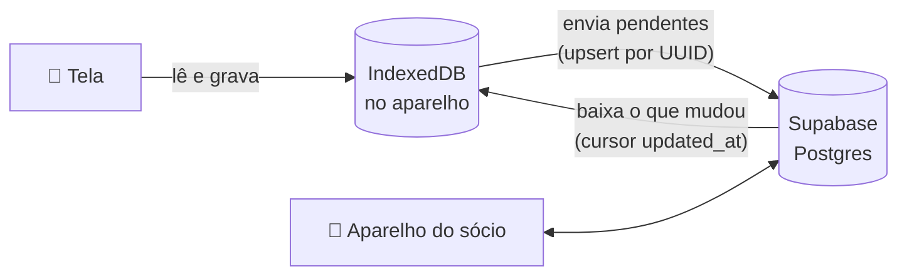

<div align="center">


# Maxbono Sorvetes

**App de vendas por rota para distribuidora de sorvetes, feito para funcionar na rua, com ou sem internet.**

Cada sócio registra os pacotes vendidos no celular, acompanha o desempenho e o financeiro da distribuidora, e tudo se sincroniza sozinho entre os aparelhos.


</div>

---

## Por que existe

Quem vende sorvete por rota passa o dia em mercadinhos, bares e cidades vizinhas, muitas vezes **sem sinal**. Anotar no papel e somar no fim do dia gera erro e retrabalho. Este app troca o caderno por um registro rápido no celular, pensado para usar com uma mão, de pé, no sol ou na câmara fria:

- **Offline de verdade:** a venda é salva no aparelho na hora e sobe sozinha quando a internet volta.
- **Poucos toques:** contador grande por produto, atalhos +5 / +10 / +20, rota e cliente lembrados.
- **Dois sócios, um só número:** o que um registra aparece para o outro, sem planilha no meio.

## Funcionalidades

### 📊 Painel
- Destaque do dia: pacotes vendidos, faturamento e vendas, com a variação em relação a ontem.
- Filtros de período (hoje, 7 dias, mês, tudo), rota e vendedor.
- Gráfico de pacotes por hora, dia ou mês; mix de produtos; ranking de rotas e de vendedores.
- Últimas vendas com foto de quem vendeu.

### 🧾 Registro de venda
- Rota e cliente/ponto (com autocompletar dos pontos já atendidos).
- Quantidade por produto: Picolé Simples, Picolé de Cobertura e Cremosinho.
- Valor calculado pelo preço padrão, com ajuste só para aquela venda (cliente com desconto, por exemplo).
- Forma de pagamento: **dinheiro**, **PIX** (QR Code e copia e cola com o valor, gerados no aparelho, funciona offline) ou **pagar depois**.
- **Pendências por rota:** quem levou e ainda não pagou aparece ao escolher a rota, para cobrar na próxima passada.
- **Recibo em PDF** com o logo da distribuidora, para compartilhar com o cliente.
- Data ajustável e observação.

### 💰 Financeiro
- Saldo do período: quanto entrou com as vendas, quanto saiu com gastos.
- Gráfico de entradas × saídas e gastos por categoria (combustível, reposição, manutenção…).
- Registro de gastos com valor, descrição, categoria, data e quem pagou.
- Tabela de preços por pacote compartilhada entre os sócios.

### 🗂️ Histórico e dados
- Vendas agrupadas por dia com pacotes e valor, filtros e exclusão.
- Forma de pagamento de cada venda, recibo em PDF e recebimento das pendências.
- Exportação para **Excel/CSV** e resumo do fechamento do dia pronto para o **WhatsApp** (produtos com emoji, valor total, pacotes e valor por rota e o que ficou a receber).
- Aviso na tela quando o aparelho sincroniza com a nuvem.

### 👤 Perfil e rotas
- Entrada por perfil + **PIN** de 4 dígitos, conferido no próprio aparelho (funciona offline).
- Foto de perfil, cargo editável e troca de PIN validada no servidor.
- Rotas com cidades atendidas: criar, editar, excluir e restaurar sem perder o histórico.

### 📱 App instalável
- PWA com ícone na tela inicial, tela cheia e todas as telas disponíveis offline.

## Como funciona

O banco local é a fonte da verdade da interface; o Supabase é o espelho que une os aparelhos.



- Cada registro nasce com um **UUID** no aparelho, então repetir o envio nunca duplica.
- Exclusões são **lógicas** (`deleted_at`) para chegarem ao outro aparelho.
- `updated_at` vem sempre do servidor: relógio errado de celular não quebra a sincronização.
- Dinheiro é guardado em **centavos inteiros**.
- Um **service worker** próprio guarda as telas e seus arquivos para abrir sem rede.

## Tecnologias

| Camada | Escolha |
|---|---|
| Interface | Next.js 16 (App Router), React 19, TypeScript |
| Estilo | Tailwind CSS 4 com tokens de tema, Atomic Design |
| Dados no aparelho | Dexie (IndexedDB) com consultas reativas |
| Servidor | Supabase (Postgres, RLS, função `security definer` para o PIN) |
| Offline | Service worker escrito à mão, manifest PWA |
| Gráficos | Componentes próprios em HTML/CSS, paleta validada para daltonismo |
| Testes | Vitest + IndexedDB falso + Supabase falso em memória |

## Estrutura

```
src/
├─ app/           telas: painel, registrar, histórico, financeiro, ajustes, login
├─ components/
│  ├─ atoms/      botões, campos, avatar, logo…
│  ├─ molecules/  stepper, teclado do PIN, diálogos, gráficos…
│  ├─ organisms/  formulário de venda, filtros, rotas, financeiro…
│  └─ templates/  casca do app e da tela de login
├─ lib/           banco local, sincronização, cálculos, filtros, exportação
├─ providers/     sessão, sincronização, PWA, avisos
└─ hooks/         leituras reativas do banco local
supabase/migrations/   esquema do banco, em ordem
```

## Qualidade

- **53 testes** cobrindo a sincronização (envio, recebimento, exclusões, pagamentos e pendências, mudanças do sócio, banco com migração faltando), cálculos de financeiro e do painel, exportação, PIX (exemplo oficial do BR Code), recibo e troca de PIN, rodando contra um Supabase falso em memória.
- Tipagem estrita de ponta a ponta e build de produção verificado a cada mudança.
- Interface testada em larguras de celular a partir de 320 px.

## Rodando localmente

```bash
npm install
cp .env.local.example .env.local   # URL e publishable key do seu projeto Supabase
npm run dev
```

O passo a passo do banco (migrações, sócios, PIN), deploy e detalhes da sincronização estão em [`docs/CONFIGURACAO.md`](docs/CONFIGURACAO.md).

## Próximos passos

- Login com Supabase Auth no lugar da chave pública com RLS aberta.
- Editar venda e gasto (hoje é apagar e registrar de novo).
- Valor em R$ e forma de pagamento na exportação CSV.

---

<div align="center">

Feito por [Joaomarcellodev](https://github.com/Joaomarcellodev) para a **Maxbono Sorvetes Distribuidora**.

</div>
